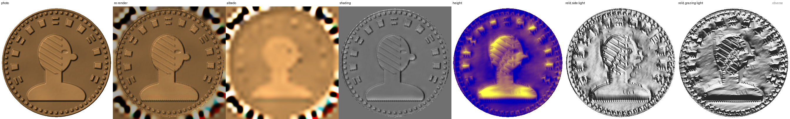

# coin3d: 3D coins from ordinary photos

Turns one photo of each side of a coin into a 3D model at real scale (`.glb`, ready for three.js, Blender or any glTF viewer).
It runs locally on a GPU, or on a CPU (slower). It needs no pretrained network and no multi-view capture: a single studio photo per side is enough.

I built it for an online shop of ancient coins (Gaulish, Roman, Greek, Byzantine), where each listing gets a 3D coin you can rotate.
This repo holds only the reconstruction part. The shop's scraping and catalogue code is not here, and neither are the supplier photos, which can't be redistributed.


*Left to right: input photo, the model's re-render, recovered albedo, recovered shading, recovered height (yellow = high), and the height relit from two new light directions.
The input is a synthetic coin made by [`examples/make_synthetic_coin.py`](examples/make_synthetic_coin.py), so its true relief is known.*

## How it works

A coin face is a **bas-relief seen from the front**, so the code doesn't deform a generic mesh. It optimises a height map `h(x, y)` directly.
This is shape-from-shading, solved as differentiable inverse rendering in PyTorch.

1. **Segmentation** ([`segment.py`](coin3d/segment.py)): cut the coin out of a plain studio background. Ancient coins aren't round, so the real outline is kept and the coin is centred in a square crop.
2. **Optional watermark removal** ([`watermark.py`](coin3d/watermark.py)): inpaint a light text overlay. Otherwise it would be read as relief.
3. **Relief recovery** ([`relief.py`](coin3d/relief.py)), with gradient descent on:
   - *unknowns*: the height (multi-scale pyramid), a **low-frequency** RGB albedo, the lighting as 2nd-order spherical harmonics (9 coefficients) plus one specular lobe;
   - *renderer*: normals from finite differences of `h`, orthographic camera, `I = albedo · SH(n) + ks · max(0, n·H)^p`;
   - *loss*: robust (Charbonnier) photometric error inside the coin, plus priors: Laplacian smoothness, a slope penalty (coins are low reliefs), "the design is raised above the field", rim anchored at 0, and a **luminance prior**: on a worn or patinated coin the high points are rubbed brighter. On real photos, this last prior is what settles whether a feature is a bump or a hollow.
   - Keeping the albedo low-frequency is the key choice: fine detail in the photo can't be absorbed as colour, so it has to be explained by geometry.
4. **Physical scale** ([`mesh.py`](coin3d/mesh.py)): the global relief depth can't be recovered from shading alone (the *bas-relief ambiguity*). The height is rescaled to about 28 % of the coin's thickness. Thickness is estimated from weight, diameter and metal density when they are given.
5. **Mesh** ([`mesh.py`](coin3d/mesh.py)): a radial mesh follows the actual outline. Obverse faces +Z, reverse faces −Z, and a generated edge joins them. Fine detail is carried by a tangent-space **normal map** baked from the full-resolution height, so the `.glb` stays around 1–2 MB. The output has PBR material presets per metal.

On an RTX 5050 a face takes about 20–40 s at 384×384 and 600 iterations.

## Usage

```bash
python -m venv .venv && source .venv/bin/activate          # Windows: .venv\Scripts\activate
pip install torch --index-url https://download.pytorch.org/whl/cu128   # or the CPU wheel
pip install -e ".[dev]"

# try it on the synthetic coin
python examples/make_synthetic_coin.py examples/synthetic
python -m coin3d examples/synthetic/obverse.png examples/synthetic/reverse.png -o out \
       --diameter 20 --weight 4 --metal bronze

# your own photos (coin on a plain light background, one photo per side)
python -m coin3d heads.jpg tails.jpg -o out/my_coin --diameter 19.5 --weight 7.3 --metal gold
```

Output in `out/`: `model.glb`, `obverse_height_mm.npy` / `reverse_height_mm.npy` (relief in mm), `debug_*.png` (the sheet above), `thumb.jpg` and `report.json` (fit error, timings, size).
You can open the `.glb` in any glTF viewer, for example https://gltf-viewer.donmccurdy.com/.

Useful options: `--iters`, `--resolution`, `--watermark`, `--no-debug`. Tuning knobs are in `ReliefParams` ([`relief.py`](coin3d/relief.py)).
`param="slopes"` swaps the height pyramid for optimising the slopes and integrating them globally (Frankot–Chellappa).

## Tests

```bash
pytest
```

The tests render a known synthetic relief and check that it is recovered with the right sign (not inverted) and a good photometric fit.
They also check that slope integration round-trips, that cropping works on a white background, and that the mesh has the right orientation and real scale (metres).

## Limits

- One photo per side: the height of large flat areas comes mostly from the luminance prior, not from shading.
- Scratches and patina can show up as micro-relief.
- The coin's edge is generated, not photographed.
- The absolute relief depth is a physical estimate, not a measurement.

## Layout

```
coin3d/
  cli.py        python -m coin3d ...
  pipeline.py   photo(s) -> crops -> relief -> mesh -> .glb + report
  segment.py    coin cut-out and square crop
  watermark.py  optional watermark inpainting
  relief.py     differentiable renderer + optimisation -> height map
  mesh.py       height maps -> closed, textured, real-scale mesh (GLB)
  debug.py      visual check sheet
examples/make_synthetic_coin.py   synthetic test coin with known relief
tests/                             synthetic checks
```

MIT licence.
